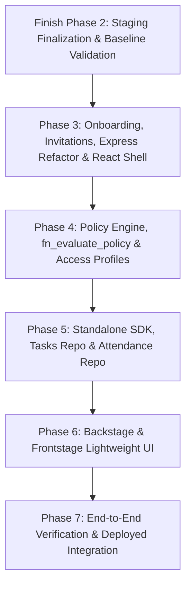

# XAuth Alignment & Architecture Proposal

**Document:** `docs/XAUTH_ALIGNMENT.md`  
**Reference Assignment:** XAuth — Modular Authentication & RBAC Foundation (Developer Assignment Version 4.0)  
**Governance:** Read-only analysis adhering strictly to `AGENT_RULES.md` and `docs/PHASE2_RLS_DESIGN.md`.

---

## 1. Executive Summary & Core Mapping

The XAuth v4.0 specification defines a modular authentication and authorization foundation tested through two independent test applications: **Tasks** and **Attendance**.

ArchScale V5's core architecture (`archscale_app_runtime`, `access_contexts`, cryptographic identity providers, definer functions, and gate-based `decide()`) provides an industrial-grade backbone that already solves the hardest multi-tenant security challenges (RLS leakage prevention, AAL2 MFA gates, session and context spoofing resistance).

However, XAuth v4.0 introduces distinct business-layer concepts to be integrated in future phases:
1. **Hierarchical reporting & organizational structure**: `department`, `job_role`, and direct reporting (`reporting_manager_membership_id`) attached to memberships.
2. **Unified SQL relationship & exception policy evaluation**: Cross-team read exceptions and ownership-based row permissions evaluated in a unified SQL function used both by PostgreSQL RLS on application tables and by `decide()`, with zero hardcoded role or job names.
3. **Role & Privilege Differentiation**: Differentiating managers (`Design Manager`, `Accounts Manager`, `HR Manager`) and juniors (`Junior Designer`, `Junior Accountant`, `Junior HR`) across the ladder roles (`manager_coordinator` and `executive`).
4. **Application modularity & independent plug-and-play**: Tasks and Attendance applications interacting with an extracted auth SDK with decoupled permission registration and record fact loaders.
5. **Attendance strict privacy isolation**: An HR-confidential silo where Tenant Admins (`business_owner`) have zero attendance permissions, and comments are append-only.
6. **Full invitation lifecycle & Frontstage/Backstage lightweight UI**: Aligning the database `invitations` table with Supabase Auth invitation mechanics and token dispatch.

---

## 2. Gap Analysis Table (Sections 01–18) — Revised after Part 0 Verification

> **Rules for Status:**  
> - **DONE**: Points to an existing implementation file AND a passing test in the test suite.  
> - **PARTIAL**: Capability exists in code or database but lacks full test coverage, complete endpoints, or UI.  
> - **MISSING**: Not present in the codebase at all.  
> - Staging claims marked **[VERIFIED]** show the exact read-only query and its result.

| Sec | Assignment Title | Status | Implementation File(s) | Passing Test(s) | Staging Evidence |
| :--- | :--- | :---: | :--- | :--- | :--- |
| **01** | Foundation Setup | **PARTIAL** | `src/server/index.ts`, `src/authz/decide.ts`, `migrations/013_context_rls_and_authz_functions.sql` | `tests/server/http_server.test.ts` (10/10), `tests/authz/01_denials.test.ts` (11/11) | **[VERIFIED]** `SELECT proname FROM pg_proc WHERE proname = 'fn_create_access_context'` → 1 row |
| **02** | Basic Lightweight UI | **PARTIAL** | `src/server/public/index.html` (vanilla HTML/JS test harness) | *None — manual UI only* | N/A |
| **03** | Development Environment & GitHub | **PARTIAL** | `tests/setup/db_connection.ts`, `src/identity/providers/local.ts` | `tests/setup/test_db_guard.test.ts` (7/7), `tests/identity/local_identity.test.ts` (9/9 — test 9 proves guard) | **[VERIFIED]** Guard confirmed: `LocalProvider` throws `SECURITY VIOLATION` when `SUPABASE_URL` contains `supabase.co` |
| **04** | Authentication & Invitations | **PARTIAL** | `src/identity/providers/supabase.ts`, `src/utils/totp.ts`, `migrations/004_...` | `tests/server/http_server.test.ts` test 10 (MFA aal1→aal2), `tests/staging/staging_authz.test.ts` (5/5) | **[VERIFIED]** `SELECT column_name FROM information_schema.columns WHERE table_name='invitations'` — table exists with `token_hash`, `status`; missing `'Sent'` status value |
| **05** | Super Admin — Backstage | **PARTIAL** | `src/authz/decide.ts` (Gate 5 support check), `migrations/005_approvals_and_support_access.sql`, `migrations/013_...` | `tests/authz/01_denials.test.ts` (Gate 5 tests), `tests/staging/staging_authz.test.ts` test 2 (founder aal2 → 200) | **[VERIFIED]** `SELECT permission_key FROM role_permissions WHERE role_key='founder'` → includes `platform.organisations.read`, `platform.support.grant` |
| **06** | Tenant Admin — Frontstage | **PARTIAL** | `src/context/access_context.ts`, `src/context/memberships.ts` | `tests/migrations/09_context_rls_and_functions.test.ts` (13/13), staging test 1 (business_owner aal2 → invite 200) | **[VERIFIED]** `SELECT column_name FROM information_schema.columns WHERE table_name='access_contexts' AND column_name='support_grant_id'` → 1 row |
| **07** | Test Tenant & Team Structure | **PARTIAL** | `migrations/001_core_types_and_identities.sql`, `scripts/seed_staging_users.ts` | `tests/migrations/01_schema_and_types.test.ts` (7/7) | **[VERIFIED]** `SELECT key, portal FROM roles ORDER BY portal, level` → 11 rows (4 platform + 7 subscriber); 7 fixture users kept (newest set from delete script) |
| **08** | Test Application A — Tasks | **MISSING** | *None* | *None* | N/A |
| **09** | Tasks — Design Manager Visibility Exception | **MISSING** | *None* | *None* | N/A |
| **10** | Test Application B — Attendance | **MISSING** | *None* | *None* | N/A |
| **11** | Attendance — Restricted Access | **MISSING** | No `attendance.*` permission keys registered in `permissions` table; no schema for attendance records | *None* | **[VERIFIED]** `SELECT permission_key FROM role_permissions WHERE permission_key LIKE 'attendance.%'` → 0 rows |
| **12** | Reusable RBAC Controller | **PARTIAL** | `src/authz/decide.ts` (9 gates), `src/config/route_permissions.ts` | `tests/authz/01_denials.test.ts` (11/11), `tests/authz/02_allowed.test.ts` (8/8) | **[VERIFIED]** `SELECT role_key, permission_key FROM role_permissions WHERE role_key='business_owner' AND permission_key='org.members.invite'` → 1 row |
| **13** | RBAC Management UI | **MISSING** | *None* | *None* | N/A |
| **14** | User ID, Work ID & Ownership Testing | **PARTIAL** | `migrations/012_secure_user_mirror_access.sql`, `public.users.user_code` | `tests/migrations/08_user_mirror_secure_access.test.ts` (12/12) | **[VERIFIED]** `SELECT proname FROM pg_proc WHERE proname='fn_resolve_user_code'` → 1 row |
| **15** | Multi-Tenant & Modular Testing | **PARTIAL** | `migrations/013_context_rls_and_authz_functions.sql` | `tests/migrations/09_context_rls_and_functions.test.ts` (13/13) | **[VERIFIED]** staging_authz test 4: no-membership user → 0 memberships, context creation returns 400 |
| **16** | Key Testing Checklist | **PARTIAL** | `tests/server/http_server.test.ts` | `tests/server/http_server.test.ts` (10/10) | **[VERIFIED]** staging tests: intern denied (403 `AUTH_PERMISSION`), business_owner aal1 denied (403 `AUTH_AAL`), aal2 allowed (200), founder aal2 allowed, logout kills both token and context |
| **17** | Developer Handover | **PARTIAL** | `docs/PHASE2_RUNBOOK.md`, `postman/archscale_phase2.http` | *Local suite 99/99 passing* | **[VERIFIED]** Staging fixture users active (7 users, see 0.5 output) |
| **18** | Testing, Supabase Setup & Future Integration | **PARTIAL** | `migrations/001-013`, `seeds/001-002`, `scripts/apply_one_migration.ts` | Local full suite: 14 files, 99 tests | **[VERIFIED]** `SELECT count(*) FROM pg_proc WHERE proname IN ('fn_create_access_context','fn_set_app_context','is_context_valid','fn_revoke_access_context')` → 4 rows |

---

## 3. Schema & Architecture Proposal (Document Only — No SQL Applied)

### A. Unified SQL Relationship & Exception Policy Evaluation

The assignment strictly mandates: **"Implement the exception through configurable authorization policies, not hardcoded names."**  
Furthermore, to prevent drift between application-layer authorization and PostgreSQL database Row Level Security, the rules must be evaluated by a **single canonical SQL function used both by PostgreSQL RLS on application tables and by `decide()`**, with an automated conformance test.

#### Data-Driven Policy Schema
```sql
CREATE TABLE IF NOT EXISTS authorization_policies (
    id UUID PRIMARY KEY DEFAULT gen_random_uuid(),
    organisation_id UUID REFERENCES organisations(id) ON DELETE CASCADE, -- NULL = global default
    resource_type TEXT NOT NULL,                                         -- e.g. 'task', 'attendance'
    action TEXT NOT NULL,                                                -- e.g. 'view', 'edit', 'reassign', 'approve'
    target_rule TEXT NOT NULL,                                           -- 'own_record', 'direct_reports', 'peer_group_read', 'explicit_grant'
    source_role_key TEXT REFERENCES roles(key),
    source_department TEXT,
    source_job_role TEXT,
    effect TEXT NOT NULL CHECK (effect IN ('ALLOW', 'DENY')),
    priority INT NOT NULL DEFAULT 100,
    created_at TIMESTAMPTZ NOT NULL DEFAULT now()
);
```

#### The Unified Security Definer Function: `fn_evaluate_policy`
```sql
CREATE OR REPLACE FUNCTION fn_evaluate_policy(
    p_context_id UUID,
    p_resource_type TEXT,
    p_action TEXT,
    p_record_department TEXT,
    p_record_owner_membership_id UUID,
    p_record_assignee_membership_id UUID
)
RETURNS BOOLEAN
LANGUAGE plpgsql
SECURITY DEFINER
SET search_path = public, pg_temp
AS $$
DECLARE
    v_actor_membership_id UUID;
    v_actor_department TEXT;
    v_actor_job_role TEXT;
    v_actor_role_key TEXT;
    v_is_direct_report BOOLEAN := false;
BEGIN
    -- 1. Invariant check: Context must be valid
    IF NOT is_context_valid(p_context_id) THEN
        RETURN false;
    END IF;

    -- 2. Extract actor attributes bound to context
    SELECT m.id, m.department, m.job_role, m.role_key
    INTO v_actor_membership_id, v_actor_department, v_actor_job_role, v_actor_role_key
    FROM access_contexts ac
    JOIN memberships m ON m.id = ac.membership_id
    WHERE ac.id = p_context_id;

    IF v_actor_membership_id IS NULL THEN
        RETURN false;
    END IF;

    -- 3. Check direct reporting relationship if assignee provided
    IF p_record_assignee_membership_id IS NOT NULL THEN
        SELECT EXISTS (
            SELECT 1 FROM memberships
            WHERE id = p_record_assignee_membership_id
              AND reporting_manager_membership_id = v_actor_membership_id
        ) INTO v_is_direct_report;
    END IF;

    -- 4. Dynamic evaluation against authorization_policies (Ordered by priority)
    -- Rule: own_record
    IF (v_actor_membership_id = p_record_assignee_membership_id OR v_actor_membership_id = p_record_owner_membership_id) THEN
        IF EXISTS (
            SELECT 1 FROM authorization_policies
            WHERE resource_type = p_resource_type
              AND action = p_action
              AND target_rule = 'own_record'
              AND effect = 'ALLOW'
        ) THEN
            RETURN true;
        END IF;
    END IF;

    -- Rule: direct_reports
    IF v_is_direct_report THEN
        IF EXISTS (
            SELECT 1 FROM authorization_policies
            WHERE resource_type = p_resource_type
              AND action = p_action
              AND target_rule = 'direct_reports'
              AND effect = 'ALLOW'
        ) THEN
            RETURN true;
        END IF;
    END IF;

    -- Rule: peer_group_read (e.g. Design Manager cross-team read)
    IF (v_actor_department = p_record_department) THEN
        IF EXISTS (
            SELECT 1 FROM authorization_policies
            WHERE resource_type = p_resource_type
              AND action = p_action
              AND target_rule = 'peer_group_read'
              AND source_department = v_actor_department
              AND source_job_role = v_actor_job_role
              AND effect = 'ALLOW'
        ) THEN
            RETURN true;
        END IF;
    END IF;

    -- DENY by default
    RETURN false;
END;
$$;
```

#### Dual Consumption:
1. **In PostgreSQL RLS Policy on `tasks`**:
   ```sql
   CREATE POLICY tasks_access_policy ON tasks
   FOR ALL TO archscale_app_runtime
   USING (
       fn_evaluate_policy(
           NULLIF(current_setting('archscale.current_context_id', true), '')::uuid,
           'task',
           'view',
           department,
           created_by_membership_id,
           assigned_to_membership_id
       )
   );
   ```
2. **In Application `decide()`**:
   TypeScript calls `fn_evaluate_policy` via client query during Gate 9 or evaluates the identical deterministic logic against cached policy tables.
3. **Automated Conformance Test**: A dedicated test suite will run both direct SQL `SELECT` via runtime pool and `decide()` API calls with identical inputs, verifying that the boolean decisions match 100% across all permutations.

---

### B. Role & Privilege Differentiation: Managers & Juniors

The assignment features:
- **Managers**: `Design Manager`, `Accounts Manager`, `HR Manager`
- **Juniors**: `Junior Designer`, `Junior Accountant`, `Junior HR`

All three managers map to the existing ladder role `manager_coordinator` (level 30), and all three juniors map to `executive` (level 40). However, they require radically different privileges: HR Manager has full tenant attendance access, while Design Manager and Accounts Manager have zero attendance access.

We evaluate two architectural approaches:

#### Approach 1: Extend `access_profiles` to attach to any ladder role (Recommended)
- **Mechanism**: Currently `access_profiles` attaches optionally to a membership. We allow `access_profiles` to bind to any role on the ladder, providing a bundle of scoped permission grants and department associations. For example:
  - Profile `profile_hr_manager`: role `manager_coordinator`, grants `attendance.records.*`, `tasks.*`, department `HR`.
  - Profile `profile_design_manager`: role `manager_coordinator`, grants `tasks.*` (NO attendance), department `Design`.
  - Profile `profile_junior_hr`: role `executive`, grants `attendance.comments.create`, department `HR`.
- **Consequences**:
  - *Pros*: Preserves the strict 11-role hierarchy. Decouples job titles from RBAC levels. Fits cleanly into `memberships.profile_id`.
  - *Cons*: Requires an extra relational join to `profile_permissions` when calculating effective permissions.

#### Approach 2: Department-Scoped Permission Grants
- **Mechanism**: Extend the `role_permissions` join table or introduce `department_permissions` (`department`, `role_key`, `permission_key`). Permissions are only active if the membership's `department` matches the grant.
- **Consequences**:
  - *Pros*: Direct calculation based on `memberships.department`.
  - *Cons*: Violates clean role modeling by fragmenting permissions across departments, making auditing and cross-department collaboration complex.

**Recommendation:** **Approach 1 (`access_profiles`)**. It maintains strict RBAC integrity, keeps the core role ladder immutable, and allows flexible bundling of departmental permissions.

---

### C. Invitations Reconciliation with Supabase Auth

The assignment specifies: `Pending`, `Sent`, `Accepted`, `Expired`, `Revoked`.

#### Database Reconciliation
```sql
ALTER TABLE invitations 
    DROP CONSTRAINT IF EXISTS invitations_status_check,
    ADD CONSTRAINT invitations_status_check 
    CHECK (status IN ('PENDING', 'SENT', 'ACCEPTED', 'EXPIRED', 'REVOKED'));
```

#### Supabase Auth Integration Flow
1. **Creation (`PENDING`)**: Tenant Admin submits invite via Frontstage. Token generated, hashed via SHA-256 into `invitations.token_hash`.
2. **Dispatch (`SENT`)**: The backend calls Supabase Admin API:
   ```typescript
   await adminClient.auth.admin.inviteUserByEmail(email, {
       data: { invitation_token: rawToken, org_id: orgId }
   });
   ```
   Upon successful dispatch, status transitions to `SENT`.
3. **Resend**: Generates a new raw token, updates `token_hash`, extends `expires_at`, triggers email redispatch, and remains `SENT`.
4. **Acceptance (`ACCEPTED`)**:
   - Invitee clicks link in email, arrives at Frontstage `/accept-invite?token=...`.
   - Backend verifies token hash, verifies `expires_at > now()`, confirms user in Supabase Auth.
   - Syncs `public.users` via `fn_upsert_user_mirror`.
   - Provisions `memberships` row with role, profile, department, and reporting manager.
   - Updates invitation status to `ACCEPTED` with `used_at = now()`.
5. **Revocation (`REVOKED`)**: Admin cancels invite. Status updated to `REVOKED`. Token rejected if attempted.

---

### D. Express Migration Strategy

The assignment specifies **Node.js + Express**. Currently, `src/server/index.ts` uses raw Node.js `http.createServer()`.

#### Migration Plan:
1. Retain the exact route specifications and JSON payload schemas.
2. Replace `http.createServer` with Express 5 / Express 4 router:
   - Middleware for context extraction: `req.contextId = req.headers['x-archscale-context']`.
   - Error handler middleware enforcing identical 401/403/404/500 JSON shapes.
3. **Regression Safety**: All 10 existing tests in [`tests/server/http_server.test.ts`](file:///c:/Users/NEELS/Desktop/ArchScale%20V5/tests/server/http_server.test.ts) test the server over real HTTP (`fetch('http://127.0.0.1:3000/...')`). Running `tests/server/http_server.test.ts` during the refactor provides 100% regression validation.

---

### E. Minimal React + TypeScript Shell (Phase 3)

In Phase 3, build a lightweight React + Vite + TypeScript frontend inside `packages/foundation/ui` (or `src/ui`):
- **Components**: Shared compact table, drawer pattern, status badge.
- **Screens**:
  1. Login & MFA Verify screen (handling 6-digit TOTP challenge).
  2. Invitation Acceptance screen (`/accept-invite?token=...` with password set).
  3. Workspace & Context Switcher.

---

## 4. Recorded User Decisions

1. **Repository Layout**:
   - **Three private GitHub repositories** per the assignment:
     - `xauth-foundation`: This repo becomes the foundation repository.
     - `xauth-tasks-test`: Independent Tasks app repository (created in Phase 5).
     - `xauth-attendance-test`: Independent Attendance app repository (created in Phase 5).
   - **SDK Isolation**: The Foundation SDK will live in a dedicated folder (`packages/sdk` or `src/sdk`) with **strictly zero imports from server internals**, allowing clean standalone publishing/extraction.
2. **MFA Enforcement & Fixture Decision**:
   - **Per-organisation setting with a platform floor**:
     - Platform roles (`founder`, `developer`, `client_servicing`, `accounts`) and `business_owner` are permanently locked to `aal2` (roles.min_aal).
     - Tenant organisations get a configurable setting (`organisations.member_min_aal`, default `'aal2'`).
     - A Tenant Admin (`business_owner` at `aal2`) can lower the tenant setting to `'aal1'` or raise to `'aal2'`, but setting `'aal1'` can **never** lower a role whose `roles.min_aal` is `'aal2'`.
     - Changing tenant MFA settings requires step-up authentication (`business_owner` at `aal2` via `fn_set_organisation_mfa_requirement`).
   - **Fixture Decision for Test Tenants**:
     - **Scenario test tenants set `member_min_aal = 'aal1'` explicitly**: In initial seed data and staging fixtures, only platform roles and `business_owner` are enrolled with TOTP MFA factors (`aal2`). Sub-owner tenant roles (`leader`, `manager_coordinator`, `executive`, `intern`, `collaborator`, `guest`) authenticate at `aal1`. If scenario test tenants were not set to `'aal1'`, baseline operational tests for these members would be blocked by Gate 8 `AUTH_AAL` before evaluating permission and hierarchy rules.
     - **ONE test tenant retains the `'aal2'` default**: To prove and continuously verify that tenant-wide MFA enforcement works as designed, at least one test tenant retains the `'aal2'` default (verified in `tests/authz/02_allowed.test.ts` test 2b and `tests/migrations/10_organisational_hierarchy.test.ts` test 6), proving that a `leader` at `aal1` is strictly denied with `AUTH_AAL`, and when elevated to `aal2` is allowed.
3. **Email Delivery**:
   - Custom SMTP configured in Supabase Auth (not Supabase's default rate-limited sender).

---

## 5. Phase Plan & Next Steps



- **Phase 2 (Current Baseline)**: Finished and verified. Staging has migrations 001–013 applied with zero regressions.
- **Phase 3 (Next Step)**:
  - Express refactor of server with HTTP test suite regression guard.
  - Invitations state machine & Supabase Auth invite integration.
  - Minimal React + TS shell for Login, MFA, and Invite acceptance.
  - Database migration 014 for `department`, `job_role`, `reporting_manager_membership_id` on `memberships`.
