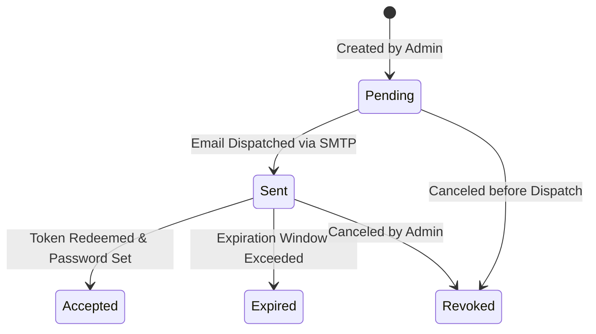
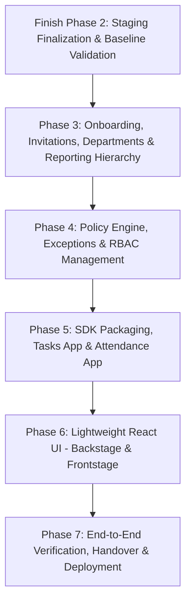

# XAuth Alignment & Architecture Proposal

**Document:** `docs/XAUTH_ALIGNMENT.md`  
**Reference Assignment:** XAuth — Modular Authentication & RBAC Foundation (Developer Assignment Version 4.0)  
**Governance:** Read-only analysis adhering strictly to `AGENT_RULES.md` and `docs/PHASE2_RLS_DESIGN.md`.

---

## 1. Executive Summary & Core Mapping

The XAuth v4.0 specification defines a modular authentication and authorization foundation tested through two independent test applications: **Tasks** and **Attendance**.

ArchScale V5's core architecture (`archscale_app_runtime`, `access_contexts`, cryptographic identity providers, definer functions, and gate-based `decide()`) provides an industrial-grade backbone that already solves the hardest multi-tenant security challenges (RLS leakage prevention, AAL2 MFA gates, session and context spoofing resistance).

However, XAuth v4.0 introduces distinct business-layer concepts not yet modelled in ArchScale V5:
1. **Hierarchical reporting & organizational structure**: `department`, `job_role`, and direct reporting (`reporting_manager_membership_id`) attached to memberships.
2. **Dynamic relationship & exception policies**: Cross-team read exceptions (e.g. Design Managers peer visibility) and ownership-based row permissions evaluated dynamically without hardcoded role names in the decision engine.
3. **Application modularity & independent plug-and-play**: Tasks and Attendance applications interacting with an auth SDK with decoupled permission registration and record fact extractors.
4. **Attendance strict privacy isolation**: An HR-confidential silo where even Tenant Admins (`business_owner`) are denied access by default, and comments are append-only.
5. **Full invitation lifecycle & Frontstage/Backstage lightweight UI**.

---

## 2. Gap Analysis Table (Sections 01–18)

| Section | Assignment Topic | Status | Supporting Files / Tables / Implementation Notes |
| :--- | :--- | :---: | :--- |
| **01** | Foundation Setup | **PARTIAL** | Core auth foundation exists (`src/server/index.ts`, `src/authz/decide.ts`, `migrations/013_context_rls_and_authz_functions.sql`). Platform vs subscriber portals exist. Missing: formal standalone SDK packaging and dedicated Backstage vs Frontstage UI surfaces. |
| **02** | Basic Lightweight UI | **PARTIAL** | Minimal vanilla HTML/JS test harness exists at `src/server/public/index.html`. Missing: Unified React+TypeScript interface, shared table/drawer patterns, and Backstage/Frontstage screen sets. |
| **03** | Development Environment & GitHub | **PARTIAL** | Local test harness (`vitest`, PGLite, LocalProvider) and staging environment exist. Missing: Repository split or monorepo workspace isolation for `xauth-tasks-test` and `xauth-attendance-test`. |
| **04** | Authentication & Invitations | **PARTIAL** | Email/pass, JWT verification, session revocation, MFA TOTP (AAL2) are **DONE** (`src/identity/providers/`, `src/utils/totp.ts`). Schema table `invitations` exists (`004_workspaces_memberships_and_contexts.sql`). Missing: 'Sent' status (current check has `PENDING, ACCEPTED, EXPIRED, REVOKED`), SMTP email delivery, token acceptance API/flow. |
| **05** | Super Admin — Backstage | **PARTIAL** | Platform portal, roles (`founder`, `client_servicing`), audited support access grants (`005_approvals_...`, `013_...`) are **DONE**. Missing: Dedicated Backstage UI screens and tenant management/invite endpoints. |
| **06** | Tenant Admin — Frontstage | **PARTIAL** | Tenant isolation, workspace scoping, membership loading, and context creation are **DONE**. Missing: Department/job role/reporting manager assignment APIs and Frontstage UI. |
| **07** | Test Tenant & Team Structure | **PARTIAL** | 11 roles exist in `roles` (`001_roles.sql`). Seed script creates test tenants and fixture users (`scripts/seed_staging_users.ts`). Missing: `department`, `job_role`, `reporting_manager` columns on `memberships`, and the exact 11-member design/HR/accounts hierarchy. |
| **08** | Test Application A — Tasks | **MISSING** | No `tasks` table, migration, or endpoints exist in the codebase. |
| **09** | Tasks — Design Manager Visibility Exception | **MISSING** | `decide()` currently supports RBAC + portal + tenant type + AAL. Relationship evaluation (direct reports, peer managers) and cross-team exception rules are not yet implemented. |
| **10** | Test Application B — Attendance | **MISSING** | No `attendance` or `attendance_comments` tables, migrations, or endpoints exist in the codebase. |
| **11** | Attendance — Restricted Access Matrix | **PARTIAL** | Permission gating logic exists in `decide()`. Missing: `attendance.*` permission seed definitions and verification that `business_owner` receives 0 attendance permissions. |
| **12** | Reusable RBAC Controller | **PARTIAL** | `decide.ts` enforces 9 gates including context validity, active membership, tenant type, portal match, permissions, and min_aal. Missing: Relationship dimension (reporting hierarchy, record ownership, approval authority, explicit exception rules). |
| **13** | RBAC Management UI | **MISSING** | No UI exists for viewing/editing role-permission matrices, department selectors, or effective user permission previews. |
| **14** | User ID, Work ID & Ownership Testing | **PARTIAL** | Unique `user_id` (`users.id` UUID) and human-readable `userCode` (`users.user_code`) exist (`012_...`). Work ID / Task ID, Creator vs Assignee vs Reviewer vs Approver dimensions are not yet built. |
| **15** | Multi-Tenant & Modular Testing | **PARTIAL** | Multi-tenant isolation verified by test suite (`tests/staging/staging_authz.test.ts`). Missing: App plug-and-play disconnect/reconnect tests for Tasks and Attendance. |
| **16** | Key Testing Checklist | **PARTIAL** | Authentication, JWT, MFA, session expiry, and tenant switching verified. Tasks and Attendance checklists cannot be run until apps are created. |
| **17** | Developer Handover | **PARTIAL** | Phase 2 Runbook, HTTP tests, and migrations 001–013 exist. Missing: Standalone repos, React UI, SDK docs. |
| **18** | Testing, Supabase Setup & Future Integration | **PARTIAL** | Stages 1 & 2 (Local + Supabase staging integration, migrations, RLS) are **DONE**. Stages 3 & 4 (deployed frontend, Tasks/Attendance test apps) are pending. |

---

## 3. Schema Proposal (Document Only — No SQL Applied)

### A. Departments, Job Roles, and Reporting Relationships

To fulfill Section 07 without destabilizing the immutable role ladder, `memberships` will be enhanced with organizational taxonomy columns:

```sql
-- Architectural enhancement to memberships (Future Migration 014)
ALTER TABLE memberships 
    ADD COLUMN department TEXT,
    ADD COLUMN job_role TEXT,
    ADD COLUMN reporting_manager_membership_id UUID REFERENCES memberships(id) ON DELETE SET NULL;

CREATE INDEX idx_memberships_reporting ON memberships(reporting_manager_membership_id);
CREATE INDEX idx_memberships_dept ON memberships(organisation_id, department);
```

#### Relationship to Role Ladder and Access Profiles
- **Role Ladder (`roles.key`)**: Defines the *authority ceiling and base privileges* within the tenant (`business_owner`, `leader`, `manager_coordinator`, `executive`, `intern`, `collaborator`, `guest`).
- **`department`**: Logical grouping (`Design`, `Accounts`, `HR`) used for departmental scoping and isolation.
- **`job_role`**: Business title (`Design Manager`, `Junior Designer`, `Accounts Manager`, `HR Manager`).
- **`reporting_manager_membership_id`**: Self-referencing foreign key on `memberships` that establishes the direct supervisory tree within the tenant.
- **`access_profiles`**: Bundles role + optional permission overrides/seat entitlements. An access profile can set default department/role boundaries without hardcoding logic.

```
┌────────────────────────────────────────────────────────┐
│                      MEMBERSHIP                        │
├─────────────────────────┬──────────────────────────────┤
│ Core RBAC Authority     │ Organizational Position      │
│  - role_key (leader)    │  - department (Design)       │
│  - profile_id           │  - job_role (Design Manager) │
│                         │  - reporting_manager_id      │
└─────────────────────────┴──────────────────────────────┘
```

---

### B. Configurable Relationship & Exception Policy Engine

The assignment strictly mandates: **"Implement the exception through configurable authorization policies, not hardcoded names."**

`decide()` currently inspects role keys and static permission maps. We introduce a data-driven policy table:

```sql
CREATE TABLE IF NOT EXISTS authorization_policies (
    id UUID PRIMARY KEY DEFAULT gen_random_uuid(),
    organisation_id UUID REFERENCES organisations(id) ON DELETE CASCADE, -- NULL = global default
    resource_type TEXT NOT NULL,                                         -- e.g. 'task', 'attendance'
    action TEXT NOT NULL,                                                -- e.g. 'view', 'edit', 'reassign'
    target_rule TEXT NOT NULL,                                           -- 'own_record', 'direct_reports', 'same_department', 'peer_group_read', 'explicit_grant'
    source_role_key TEXT REFERENCES roles(key),
    source_department TEXT,
    source_job_role TEXT,
    effect TEXT NOT NULL CHECK (effect IN ('ALLOW', 'DENY')),
    priority INT NOT NULL DEFAULT 100,
    created_at TIMESTAMPTZ NOT NULL DEFAULT now()
);
```

#### How `decide()` Evaluates Record Facts without Hardcoding
When an app calls `decide()` with `resourceFacts`:
```typescript
interface ResourceFacts {
    resourceType: 'task' | 'attendance';
    action: 'view' | 'edit' | 'reassign' | 'approve' | 'comment';
    recordOwnerMembershipId?: string;
    recordAssigneeMembershipId?: string;
    recordReviewerMembershipId?: string;
    recordDepartment?: string;
    customAttributes?: Record<string, any>;
}
```

`decide()` executes a new Gate (Gate 9 - Policy Rules):
1. **Rule: `own_record`**: Checks if `context.membership_id === recordAssigneeMembershipId || context.membership_id === recordOwnerMembershipId`.
2. **Rule: `direct_reports`**: Checks if `recordAssignee.reporting_manager_membership_id === context.membership_id`.
3. **Rule: `peer_group_read` (The Design Manager Exception)**:
   - Configured in DB as: `resource_type='task'`, `action='view'`, `source_department='Design'`, `source_job_role='Design Manager'`, `target_rule='department_hierarchy_read'`.
   - The engine checks: Is requester `department == 'Design'` and `job_role == 'Design Manager'`?
   - If yes: allow viewing tasks where task department is `Design` across all peer teams.
   - Because no policy rule exists granting `'edit'` or `'reassign'` to peer tasks, `decide()` naturally returns `DENY` for mutations on peer tasks.

---

### C. Application Record Facts & Decoupled Loader Contract

To prevent the auth core from knowing schema details of Tasks or Attendance:
1. Each application defines and registers its permission keys into `permissions` table upon installation.
2. The Foundation SDK exposes a contract:
   ```typescript
   export interface RecordFactLoader<T> {
       resourceType: string;
       loadFacts(recordId: string, client: pg.PoolClient): Promise<ResourceFacts>;
   }
   ```
3. **Distinct Record Reference Attributes**:
   - `created_by_user_id`: Immutable author who submitted the record.
   - `assigned_to_membership_id`: The current member responsible for execution.
   - `reviewer_membership_id`: The manager or lead assigned to inspect the deliverable.
   - `approved_by_membership_id`: The authorized supervisor who stamped approval.

Reassigning a task modifies `assigned_to_membership_id` only; `created_by_user_id` remains immutable.

---

### D. Attendance Application: Strict Isolation & Permissions Matrix

#### Permission Seed Matrix
Attendance permissions are seeded strictly to HR personas:
- `attendance.records.read` -> Granted to `hr_manager`, `junior_hr` (and audited platform staff).
- `attendance.records.write` -> Granted to `hr_manager` ONLY.
- `attendance.comments.create` -> Granted to `hr_manager`, `junior_hr`.
- `attendance.export` -> Granted to `hr_manager` ONLY.

> [!IMPORTANT]
> **Tenant Admin (`business_owner`) receives ZERO `attendance.*` permissions.**  
> In ArchScale V5, permissions are never inferred from hierarchy; if `business_owner` has no row in `role_permissions` for `attendance.*`, `decide()` returns `DENY (ROLE_PERMISSION_MISSING)` automatically.

#### Append-Only Comments Schema
```sql
CREATE TABLE IF NOT EXISTS attendance_comments (
    id UUID PRIMARY KEY DEFAULT gen_random_uuid(),
    attendance_record_id UUID NOT NULL REFERENCES attendance_records(id) ON DELETE CASCADE,
    author_membership_id UUID NOT NULL REFERENCES memberships(id),
    content TEXT NOT NULL CHECK (length(trim(content)) > 0),
    created_at TIMESTAMPTZ NOT NULL DEFAULT now(),
    -- Append-only constraint: No UPDATE or DELETE policy permitted
);
```
No `UPDATE` or `DELETE` grants are given on `attendance_comments` to `archscale_app_runtime`. Audit logs record each insertion.

#### Denial of Direct URLs and Exports
- Every route handler (`/api/attendance/*`, `/api/attendance/export`) invokes `decide()` before executing SQL queries or rendering data.
- Missing context or missing permission immediately returns HTTP 403 with standard JSON error response, preventing direct URL access or data leakage.

---

### E. Invitations Lifecycle

Section 04 requires: `Pending`, `Sent`, `Accepted`, `Expired`, `Revoked`.

#### Status Flow


#### Acceptance & Approval Pipeline
1. `POST /api/invitations/accept`:
   - Validates `token_hash = sha256(supplied_token)`.
   - Validates status is `Sent` and `expires_at > now()`.
   - Creates the Supabase Auth user (or binds existing user).
   - Syncs user mirror via `fn_upsert_user_mirror`.
   - Calls existing approval definer function `fn_approve_membership()` or directly provisions the `memberships` row with pre-assigned role, department, and reporting manager.
   - Marks invitation status as `Accepted` with `used_at = now()`.

---

### F. MFA Strategy: Tenant-Configurable vs Seed-Enforced

The assignment specifies: *"MFA mandatory for Platform Super Admin; MFA configurable for tenant members"*, whereas ArchScale V5 currently hardcodes `roles.min_aal = 'aal2'` for `business_owner`.

We compare both approaches without choosing:

| Dimension | Option A: Per-Organisation Setting (`organisations.enforce_mfa`) | Option B: Static Role-Based Enforcement (`roles.min_aal = 'aal2'`) |
| :--- | :--- | :--- |
| **How it works** | A boolean column on `organisations` (`enforce_mfa BOOLEAN DEFAULT false`). If enabled for a tenant, all members (or designated tenant roles) are required to satisfy `aal2`. Platform roles remain permanently `aal2`. | The `roles` table permanently mandates `min_aal = 'aal2'` for `business_owner` and all platform roles globally across all tenants. |
| **Flexibility** | High. Tenants can decide their own security policy based on organizational maturity or tier. | Rigid. Every Business Owner must have MFA enrolled and verified on every login. |
| **Complexity** | Requires dynamic evaluation in `decide()` and during context creation (checking `organisations.enforce_mfa`). | Simple. Checked once via `context.aal >= role.min_aal`. |
| **Security Risk** | If a tenant admin disables `enforce_mfa`, a compromised business owner password grants full tenant takeover with no 2FA challenge. | Guarantees zero credential-stuffing vulnerability for the tenant root, regardless of tenant preferences. |
| **Compliance** | Matches SOC2/Enterprise configurable tenant security profiles. | Matches strict zero-trust baseline. |

---

## 4. Repository Layout Evaluation

The assignment mentions: *"Use 2–3 private GitHub repositories: xauth-foundation, xauth-tasks-test, xauth-attendance-test"*.

We evaluate two architectures:

### Option 1: Multi-Repository Layout (3 Repositories)
- `xauth-foundation`: Auth server, DB migrations, Core RBAC engine, published `@archscale/xauth-sdk`.
- `xauth-tasks-test`: Standalone Express/React app importing `@archscale/xauth-sdk` as an npm dependency.
- `xauth-attendance-test`: Standalone Express/React app importing `@archscale/xauth-sdk` as an npm dependency.

### Option 2: Monorepo Workspace (pnpm/npm workspaces in 1 Repository)
- `packages/foundation`: Core engine, migrations, server, SDK export.
- `packages/tasks`: Test app consuming `workspace:*`.
- `packages/attendance`: Test app consuming `workspace:*`.

### Comparison Matrix

| Evaluation Criteria | Option 1: Multi-Repo (3 Repos) | Option 2: Monorepo (1 Repo, 3 Packages) |
| :--- | :--- | :--- |
| **SDK Dependency** | Published via private npm registry or git submodule/local file link. | Direct package dependency (`"@archscale/xauth-sdk": "workspace:*"`). Instant compilation and type checking. |
| **Remove & Reconnect Test** | Physically run tasks app against foundation, shut down container / unlink package, verify foundation and attendance operate unaffected. | Remove package folder or run test suite with tasks package deleted/disabled; verify remaining packages pass. |
| **Impact on Current Repo** | Requires extracting current code into a new foundation repo and initializing 2 external repos. High coordination overhead. | Natural evolution of `ArchScale V5`. All git history, applied migrations (001–013), and test harnesses remain intact. |
| **CI / CD Pipeline** | 3 separate GitHub Action pipelines; cross-repo version synchronization needed. | Single atomic CI pipeline testing end-to-end integration and package decoupling in one pull request. |

### Recommendation: Monorepo Workspace (`Option 2`)
**Recommendation:** Organize as an **npm/pnpm workspace within this repository**.  
It provides strict modular package boundary separation (proving that Tasks and Attendance have zero interdependencies and can be removed independently) while preserving the verified migrations (001–013), staging test suites, and strict agent rules without cross-repo git synchronization friction. If strict external git separation is required at handover, packages can be mirrored into separate GitHub repositories via `git subtree`.

---

## 5. Phase Plan & Order of Execution

We confirm the phased order of execution with necessary refinements:



1. **Finish Phase 2 (Current Baseline)**: Validate staging state, ensure zero regressions on migrations 001–013 and seed data.
2. **Phase 3: Onboarding & Org Hierarchy**:
   - Schema update: `department`, `job_role`, `reporting_manager_membership_id` on `memberships`.
   - Full invitation state machine (`Pending`, `Sent`, `Accepted`, `Expired`, `Revoked`).
   - Email dispatch integration (Supabase Auth / SMTP).
3. **Phase 4: Policy Engine & Cross-Team Exceptions**:
   - `authorization_policies` table.
   - `decide()` Gate 9 implementation for dynamic relationship rules (own records, direct reports, Design Manager peer view exception).
   - Strict Attendance isolation rules (Tenant Admin locked out by default).
4. **Phase 5: SDK & Independent Test Applications**:
   - Export `@archscale/xauth-sdk`.
   - Build `Tasks` application with Work ID, Assignee, Reviewer, Approver facts.
   - Build `Attendance` application with append-only comments and export protection.
   - Modular remove-and-reconnect testing.
5. **Phase 6: Basic Lightweight UI (React + TS)**:
   - Shared minimal UI design system (compact tables, drawer patterns).
   - Backstage: Super Admin login, Tenant registration, support grant viewer.
   - Frontstage: Tenant workspace switch, Member management, Tasks board, Attendance view.
6. **Phase 7: Verification & Deployed Testing**:
   - Stage 1–4 validation from Section 18.
   - Verification report.

---

## 6. Open Decisions for User Alignment

1. **Repository Structure**: Do you prefer keeping this repository as a monorepo workspace (`packages/foundation`, `packages/tasks`, `packages/attendance`), or do you require creating 2–3 distinct GitHub repositories immediately?
2. **MFA Configuration**: Should we retain the strict requirement where `business_owner` is always `aal2`, or introduce `organisations.enforce_mfa` to allow tenant-configurable MFA?
3. **Email Delivery Provider**: For real email invitation delivery in Phase 3, should we use Supabase Auth's built-in SMTP or configure external SMTP credentials (e.g. Resend / SendGrid / Postmark)?

